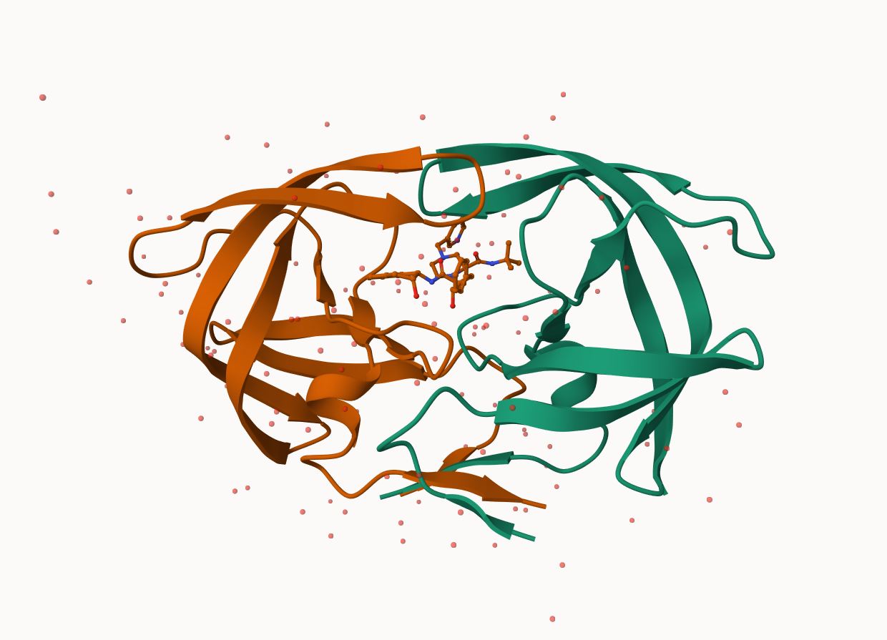
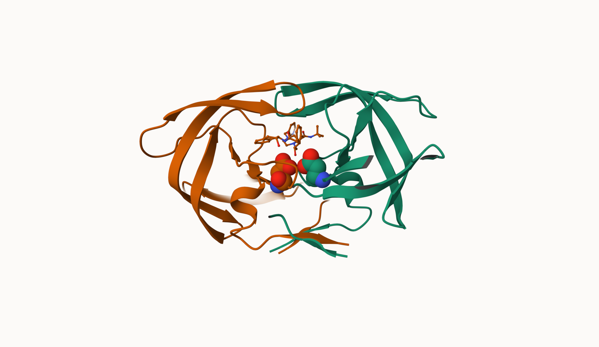
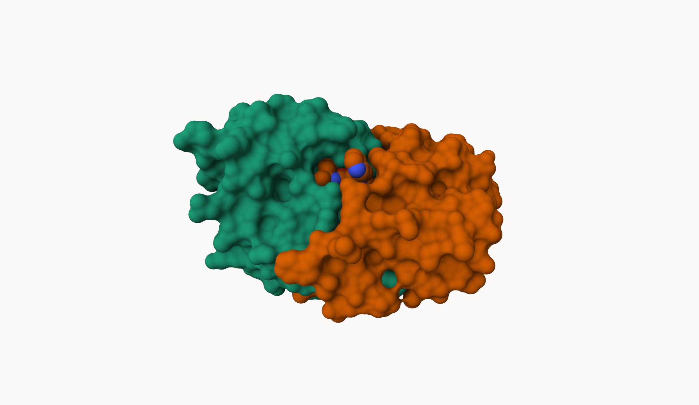
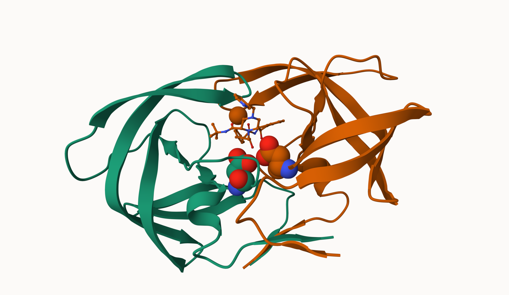

## Background 

The [PDB database](http://www.rcsb.org/) is the main repository of biomolecular structure information. Let's have a look at the composition of this database.

Visit PDB and click:
Analyze > PDB Statistics > Experimental Method > Summary

We can "scrape" data from this page with the **datapasta** package that we can install from CRAN ` install.packages("datapasta)`

Then "Addins > Paste as data.frame":

```{r}
pdb <- data.frame(
    stringsAsFactors = FALSE,
         check.names = FALSE,
         `Molecular.Type.▼` = c("Protein/Oligosaccharide","Protein/NA","Protein (only)",
                                "Other","Oligosaccharide (only)",
                                "Nucleic acid (only)","Total"),
             Xray = c(10716, 9341, 184731, 178, 11, 3216, 208193),
                  EM = c(4037, 7520, 25754, 27, 1, 347, 37686),
                 NMR = c(34, 288, 12904, 35, 6, 1599, 14866),
         Integrative = c(8L, 27L, 365L, 4L, 0L, 3L, 407L),
    Multiple.methods = c(11L, 8L, 232L, 0L, 1L, 15L, 267L),
             Neutron = c(1L, 0L, 86L, 0L, 0L, 3L, 90L),
               Other = c(0L, 0L, 32L, 0L, 4L, 1L, 37L),
               Total = c(14807, 17184, 224104, 244, 23, 5184, 261546)
       ) 
pdb
```

> **Q1.** What percentage of structures in the PDB are solved by X-ray and Electron Microscopy?

X-ray crystallography accounts for approximately 79.60% of PDB structures, while Electron Microscopy accounts for approximately 14.41%.

```{r}
# Calculate percentages
xray <- pdb$Xray[7] / pdb$Total[7] * 100
em <- pdb$EM[7] / pdb$Total[7] * 100

# Display results
round(xray, 2)
round(em, 2)

```

> **Q2** What proportion of structures in the PDB are protein?

Approximately 85.68% of structures in the PDB contain only proteins.

```{r}
prot.ind <- pdb$Molecular.Type == "Protein (only)"
total.ind <- pdb$Molecular.Type == "Total"

protein <- pdb$Total[prot.ind]
total <- pdb$Total[total.ind]

round(protein / total * 100, 2)
```


> **Q3.** Skipped!

## The Mol-star viewer

This viewer is embedded into many newer bioinformatics databases including the PDB and UniProt. The viewer is also accessible from it's homepage: https://molstar.org 



HIV-Protease (or HIV-PR for short) is a critical HIV enzyme required for virus replication . It is an Aspartal protease, which means it use ASP amino acid residues to cleave proteins.






>**Q4.** Water molecules normally have 3 atoms. Why do we see just one atom per water molecule in this structure?

Only the oxygen atom is shown because the hydrogen atoms are too small to be clearly detected in the X-ray structure.

>**Q5:** There is a critical "conserved" water molecule in the binding site. What residue number does this water molecule have?

The conserved water molecule in the binding site is HOH 308.

>**Q6:** Generate and save a figure showing the two distinct chains of HIV-protease along with the ligand.

The figure below shows both chains of HIV-protease, the bound inhibitor indinavir, the catalytic ASP25 residues, and the conserved water molecule HOH 308.



>**Discussion Topic:** Can you think of a way in which indinavir, or even larger ligands and substrates, could enter the binding site?

The protein likely changes shape and opens its flexible flaps, allowing individual or other larger molecules to enter the binding site. The flaps can then close around the molecule.


## Introduction to Bio3D in R

### Reading PDB file data into R

```{r}
library(bio3d)

# Read the HIV-1 protease structure
pdb <- read.pdb("1hsg")

# Display the PDB summary
pdb
```

**Q7: How many amino acid residues are there in this PDB object?**

There are 198 amino acid residues in total.

**Q8: Name one of the two non-protein residues.**

One non-protein residue is HOH (water).

**Q9: How many protein chains are in this structure?**

There are 2 protein chains, A and B.

```{r}
# Read the HIV-1 protease structure again
hiv <- read.pdb("1hsg")

# Examine the structure attributes
attributes(hiv)

# View the atom data
head(hiv$atom)
```

