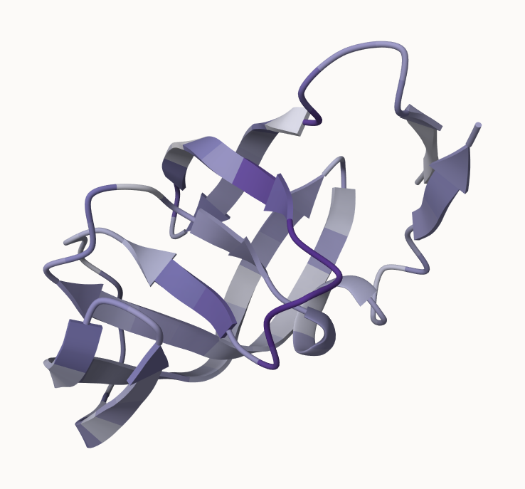
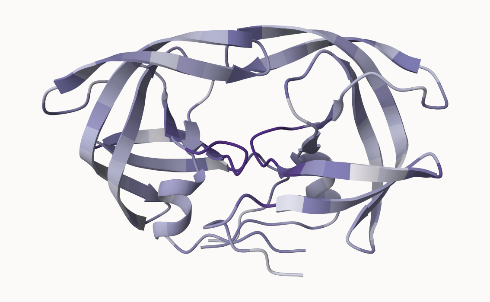
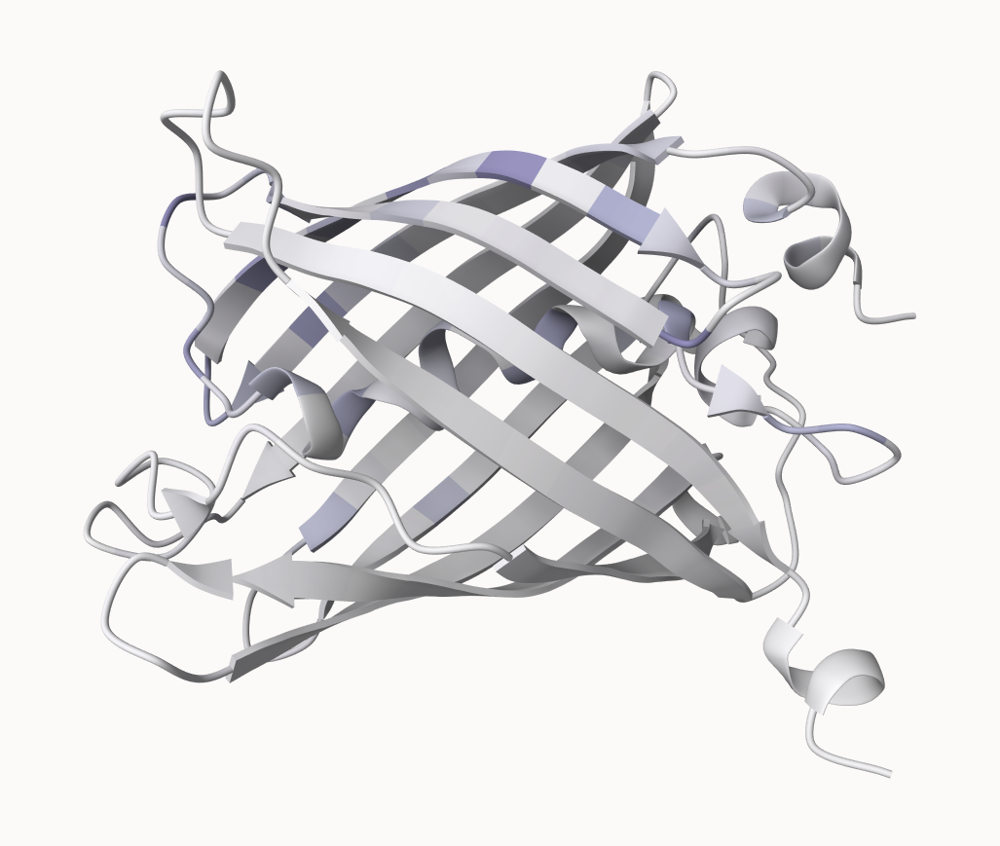

## Background

We ran 3 AlphaFold2 predictions,

- HIV-Pr_monomer
- HIV-PR_dimer
- My find-a-gene protein sequence

Here we analyze the resulting models and make some diagnostic plots that inform on model reliability.

## 1. HIV-PR Monomer

```{r}
library(bio3d)

# Find the AlphaFold results directory
results_dir <- "HIV_monomer_94b5b/"

# Find all PDB files
pdb_files <- list.files(path=results_dir,
                        pattern="\\.pdb$",
                        full.names=TRUE)

# Print the file names
basename(pdb_files)
```

Read and align all the PDB models.

```{r}
# Read and align all the PDB models
pdbs <- pdbaln(pdb_files, fit=TRUE, exefile="msa")

# View the aligned sequences
pdbs
```

Calculate the RMSD of all models to each other (i.e. pairwise RMSD).

```{r}
# Calculate pairwise RMSD
rd <- rmsd(pdbs, fit=TRUE)

# View the range of RMSD values
range(rd)
```

```{r}
library(pheatmap)

colnames(rd) <- paste0("m",1:5)
rownames(rd) <- paste0("m",1:5)

pheatmap(rd)
```

The five HIV protease monomer models were very similar, with RMSD values ranging from 0 to 1.233 Å. This suggests that AlphaFold predicted a consistent structure across the five models.

Calculate RMSF - How far apart each amino acid is across all models.

```{r}
# Calculate RMSF across all 5 models
rf <- rmsf(pdbs$xyz)

# Plot RMSF
plot(rf, type="l")
```

The RMSF graph shows that most amino acid positions have low structural variation across the five models. However, the beginning and end of the protein have higher RMSF values, suggesting these regions are less consistent between predictions.

### Residue Conservation

Read the AF MSA.

```{r}
aln_file <- list.files(path = results_dir,
                       pattern = ".a3m$",
                       full.names = TRUE)

aln_file

aln <- read.fasta(aln_file[1], to.upper = TRUE)
```

```{r}
# How many sequences are in the alignment?
dim(aln$ali)
```


We can score residue conservation in the alignment with the `conserv()` function.

```{r}
sim <- conserv(aln)
```

Plot this conservation result.

```{r}
plot(sim, type="h")
```

Generate a consensus sequence.

```{r}
con <- consensus(aln, cutoff = 0.9)
con$seq
```

For a final visualization of these functionally important sites we can map this conservation score to the Occupancy column of a PDB file for viewing in molecular viewer programs such as Mol*, PyMol, VMD, chimera etc.

```{r}
m1.pdb <- read.pdb(pdb_files[1])

length(unique(m1.pdb$atom$resno))
length(sim)
```

```{r}
occ <- vec2resno(sim[1:99], m1.pdb$atom$resno)

write.pdb(m1.pdb, o=occ, file="m1_conserv.pdb")
```

### AF scores (pLDDT & PAE score plots)

The pLDDT scores are stored in the PDB models "B-factor" col and in a separate JSON format file in the results directory. We can use either:

```{r}
plotb3(pdbs$b[1,], typ="l", lwd=2)

points(pdbs$b[2,], typ="l", col="red")
points(pdbs$b[3,], typ="l", col="blue")
points(pdbs$b[4,], typ="l", col="darkgreen")
points(pdbs$b[5,], typ="l", col="orange")

#plot(m1.pdb$atom$b[m1.pdb$calpha], typ="h")
```




## 2. HIV-PR Dimer
```{r}
library(bio3d)

# Set the dimer results directory
dimer_dir <- "HIV_dimer_23119/"

# Find all five PDB models
dimer_files <- list.files(path=dimer_dir,
                          pattern="\\.pdb$",
                          full.names=TRUE)

# Print the filenames
basename(dimer_files)
```
```{r}
# Read and align all five dimer models
dimer_pdbs <- pdbaln(dimer_files, fit=TRUE, exefile="msa")

# View the aligned sequences
dimer_pdbs
```

### RMSD

```{r}
# Calculate pairwise RMSD for all five dimer models
dimer_rd <- rmsd(dimer_pdbs, fit=TRUE)

# View the RMSD range
range(dimer_rd)
```

```{r}
library(pheatmap)

# Label the five dimer models
colnames(dimer_rd) <- paste0("m", 1:5)
rownames(dimer_rd) <- paste0("m", 1:5)

# Plot the RMSD heatmap
pheatmap(dimer_rd)
```

The five HIV protease dimer models had RMSD values ranging from 0 to 13.941 Å, showing more structural variation than the monomer models. Models 1, 2, and 3 were more similar to each other, while models 4 and 5 were more different from the first three models.

### RMSF

```{r, results='hide'}
# Find the rigid core shared by all five models
dimer_core <- core.find(dimer_pdbs)

# Identify the core positions
dimer_core.inds <- print(dimer_core, vol=0.5)

# Fit the structures using their rigid core
dimer_xyz <- pdbfit(dimer_pdbs, dimer_core.inds,
                    outpath="dimer_corefit_structures")

# Calculate RMSF
dimer_rf <- rmsf(dimer_xyz)

# Plot RMSF
plot(dimer_rf, type="l",
     xlab="Residue",
     ylab="RMSF")

abline(v=100, col="gray")
```

The RMSF graph shows that the first chain has much higher structural variation than the second chain. This suggests that the first chain changes more between the five predicted models, while the second chain stays more consistent.

### Residue Conservation

```{r}
# Find the dimer AlphaFold MSA file
dimer_aln_file <- list.files(path=dimer_dir,
                             pattern=".a3m$",
                             full.names=TRUE)

dimer_aln_file

# Read the alignment
dimer_aln <- read.fasta(dimer_aln_file[1], to.upper=TRUE)

# Check the alignment dimensions
dim(dimer_aln$ali)
```

```{r}
# Calculate residue conservation
dimer_sim <- conserv(dimer_aln)

# Plot conservation scores
plot(dimer_sim, type="h")
```
```{r}
# Generate consensus sequence with 90% cutoff
dimer_con <- consensus(dimer_aln, cutoff=0.9)

# View the consensus sequence
dimer_con$seq
```

```{r}
# Read the first dimer AlphaFold model
dimer_m1 <- read.pdb(dimer_files[1])

# Map conservation scores to both chains
dimer_occ <- vec2resno(c(dimer_sim[1:99], dimer_sim[1:99]),
                       dimer_m1$atom$resno)

# Save the conservation structure
write.pdb(dimer_m1, o=dimer_occ, file="dimer_conserv.pdb")
```



### AF scores (pLDDT & PAE score plots)

```{r}
# Plot pLDDT scores for all 5 dimer models
plotb3(dimer_pdbs$b[1,], typ="l", lwd=2,
       ylab="pLDDT Score")

points(dimer_pdbs$b[2,], typ="l", col="red")
points(dimer_pdbs$b[3,], typ="l", col="blue")
points(dimer_pdbs$b[4,], typ="l", col="darkgreen")
points(dimer_pdbs$b[5,], typ="l", col="orange")

# Separate the two chains
abline(v=100, col="gray")
```

```{r}
library(jsonlite)

# Find all PAE JSON files
dimer_pae_files <- list.files(path=dimer_dir,
                              pattern=".*model.*\\.json",
                              full.names=TRUE)

# View the filenames
basename(dimer_pae_files)

# Read the first and fifth models
dimer_pae1 <- read_json(dimer_pae_files[1],
                        simplifyVector=TRUE)

dimer_pae5 <- read_json(dimer_pae_files[5],
                        simplifyVector=TRUE)

# Check what information is available
attributes(dimer_pae1)
```

```{r}
# View the maximum PAE scores
dimer_pae1$max_pae
dimer_pae5$max_pae

# Plot PAE for model 1
plot.dmat(dimer_pae1$pae,
          xlab="Residue Position (i)",
          ylab="Residue Position (j)",
          grid.col="black",
          zlim=c(0,30))
```

```{r}
# Plot PAE for model 5
plot.dmat(dimer_pae5$pae,
          xlab="Residue Position (i)",
          ylab="Residue Position (j)",
          grid.col="black",
          zlim=c(0,30))
```

Model 1 had a maximum PAE of 12.477 Å, while Model 5 had a maximum PAE of 30.125 Å. This suggests that Model 1 has more reliable predictions of the relative positions of different parts of the protein. Model 5 has higher predicted errors, meaning there is more uncertainty in its structure.

## 3. My Find-a-Gene Protein Sequence

### Read AF Models

```{r}
library(bio3d)

# Set the Find-a-Gene results directory
gfp_dir <- "Phialella_GFP_957cb/"

# Find all five AlphaFold PDB models
gfp_files <- list.files(path=gfp_dir,
                        pattern="\\.pdb$",
                        full.names=TRUE)

# Print the filenames
basename(gfp_files)
```

```{r}
# Read and align all five GFP models
gfp_pdbs <- pdbaln(gfp_files, fit=TRUE, exefile="msa")

# View the aligned sequences
gfp_pdbs
```

### RMSD

```{r}
# Calculate pairwise RMSD for all five GFP models
gfp_rd <- rmsd(gfp_pdbs, fit=TRUE)

# View the RMSD range
range(gfp_rd)
```

```{r}
library(pheatmap)

# Label the five GFP models
colnames(gfp_rd) <- paste0("m", 1:5)
rownames(gfp_rd) <- paste0("m", 1:5)

# Plot the RMSD heatmap
pheatmap(gfp_rd)
```

The five predicted GFP homolog models had RMSD values ranging from 0 to 0.328 Å, showing very little structural variation. This suggests that AlphaFold predicted a very similar structure across all five models.

### RMSF

```{r}
# Calculate RMSF across all five GFP models
gfp_rf <- rmsf(gfp_pdbs$xyz)

# Plot RMSF
plot(gfp_rf, type="l",
     xlab="Residue",
     ylab="RMSF")
```

The RMSF graph shows that most amino acid positions have very little structural variation across the five GFP models. This suggests that the predicted structures are consistent, with only small differences in certain regions.

```{r}
# Find the GFP multiple sequence alignment file
gfp_aln_file <- list.files(path=gfp_dir,
                           pattern="\\.a3m$",
                           full.names=TRUE)

# View the filename
gfp_aln_file

# Read the alignment
gfp_aln <- read.fasta(gfp_aln_file[1], to.upper=TRUE)

# Check the alignment dimensions
dim(gfp_aln$ali)
```

### Residue Conservation

```{r}
# Calculate residue conservation
gfp_sim <- conserv(gfp_aln)

# Plot conservation scores
plot(gfp_sim, type="h",
     xlab="Alignment Position",
     ylab="Conservation Score")
```

```{r}
# Generate consensus sequence with 90% cutoff
gfp_con <- consensus(gfp_aln, cutoff=0.9)

# View the consensus sequence
gfp_con$seq
```


```{r}
# Find positions corresponding to the GFP protein sequence
gfp_positions <- which(gfp_aln$ali[1,] != "-")

# Get conservation scores for those positions
gfp_residue_sim <- gfp_sim[gfp_positions]

# Check the number of scores
length(gfp_residue_sim)

# Check the number of residues in the first model
gfp_m1 <- read.pdb(gfp_files[1])
length(unique(gfp_m1$atom$resno))
```

```{r}
# Map conservation scores to the GFP structure
gfp_occ <- vec2resno(gfp_residue_sim, gfp_m1$atom$resno)

# Save the PDB file with conservation scores
write.pdb(gfp_m1, o=gfp_occ, file="gfp_conserv.pdb")
```



### AF scores (pLDDT & PAE score plots)

```{r}
# Plot pLDDT scores for all 5 GFP models
plotb3(gfp_pdbs$b[1,], typ="l", lwd=2,
       ylab="pLDDT Score")

points(gfp_pdbs$b[2,], typ="l", col="red")
points(gfp_pdbs$b[3,], typ="l", col="blue")
points(gfp_pdbs$b[4,], typ="l", col="darkgreen")
points(gfp_pdbs$b[5,], typ="l", col="orange")
```

```{r}
library(jsonlite)

# Find the GFP PAE JSON files
gfp_pae_files <- list.files(path=gfp_dir,
                            pattern=".*model.*\\.json",
                            full.names=TRUE)

# View the filenames
basename(gfp_pae_files)

# Read models 1 and 5
gfp_pae1 <- read_json(gfp_pae_files[1],
                      simplifyVector=TRUE)

gfp_pae5 <- read_json(gfp_pae_files[5],
                      simplifyVector=TRUE)

# Check the available information
attributes(gfp_pae1)
```

```{r}
# Compare maximum PAE scores
gfp_pae1$max_pae
gfp_pae5$max_pae

# Plot PAE for GFP model 1
plot.dmat(gfp_pae1$pae,
          xlab="Residue Position (i)",
          ylab="Residue Position (j)",
          grid.col="black",
          zlim=c(0,30))
```


```{r}
# Plot PAE for GFP model 5
plot.dmat(gfp_pae5$pae,
          xlab="Residue Position (i)",
          ylab="Residue Position (j)",
          grid.col="black",
          zlim=c(0,30))
```

The PAE plots show how confident AlphaFold is about the relative positions of different parts of my GFP homolog. The blue regions indicate lower predicted errors, while the warmer colors show areas with more uncertainty. Comparing Models 1 and 5 helps show which regions were predicted more consistently.


### Final Interpretation
Model 1 had a maximum PAE of 29.781 Å, while Model 5 had a maximum PAE of 29.063 Å. Both models have similar maximum predicted errors, although Model 5 has a slightly lower value. This suggests that both models have some uncertainty in the relative positions of certain regions of the protein.

